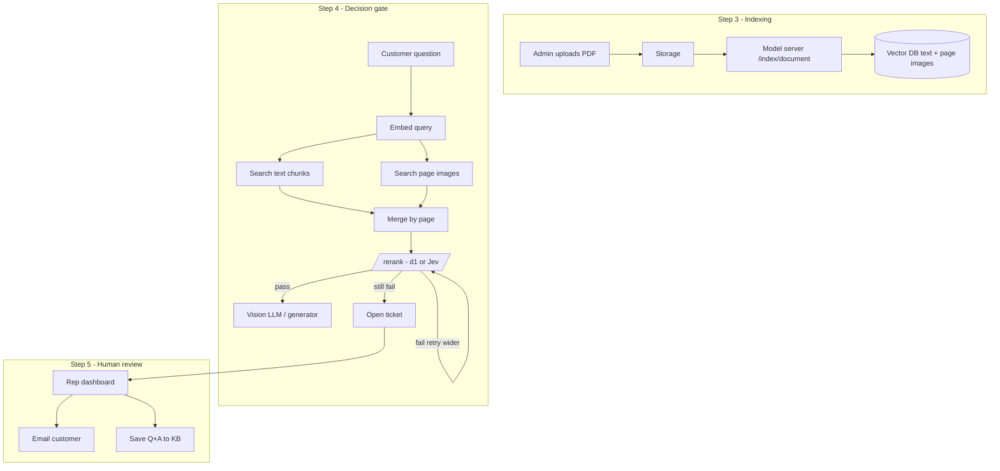

# Jev-powered Agentic RAG (local prototype)

This repo implements the **architecture from** [Build a Jev-powered Agentic RAG.pdf](./Build%20a%20Jev-powered%20Agentic%20RAG.pdf): a support desk that **retrieves** multimodal evidence, **judges** whether it is good enough using a **decision model** (OpenAI Decisions / Jev / Liquid d1), then either **generates an answer** or **escalates to a human**—and human replies can be **saved back into the knowledge base**.

For problem statement, architecture diagrams, and a **from-scratch build order**, see **[problem_statement.md](./problem_statement.md)**.

The PDF’s production stack uses **InsForge** (Postgres + pgvector, auth, edge functions) and **Lightning AI** (EmbeddingGemma 2 + d1-3B). This project gives you the **same control flow locally**, with clear swap-in points for those services.

---

## What problem “agentic RAG” solves

Classic RAG often does:

1. Embed the question  
2. Retrieve chunks  
3. **Always** call an LLM  

That fails in two ways the PDF highlights:

| Problem | Symptom | Fix in this design |
|--------|---------|-------------------|
| **Unknown unknowns** | Model hallucinates when docs don’t contain the answer | **Decision gate**: Noul questions like “is this answerable?” |
| **No action** | App still returns fluent nonsense | **Agentic branch**: open ticket, notify rep, skip generation |

**Decision models** (Jev via TypeSafe, or Liquid **d1**) return **structured probabilities**, not chat text:

- **Noul** — P(yes) for “Is this passage relevant?” / “Does it contain enough to answer?”  
- **Choice** — pick one route (billing vs technical)  
- **Score** — ordered severity / urgency  

Your app **uses thresholds** on those numbers to route workflow—not prompt tricks alone.

---

## Architecture (maps to the PDF)



### Component mapping

| PDF component | Role in this repo |
|---------------|-------------------|
| InsForge | `backend/` — API, SQLite metadata, Chroma vectors, tickets |
| Lightning model server | `model_server/` — `/embed/*`, `/rerank`, `/index/document` |
| EmbeddingGemma 2 | `shared/embeddings.py` — **local**: MiniLM via fastembed; **prod**: call your GPU server |
| d1-3B / Jev | `shared/decisions.py` — **mock**, **Liquid API**, or **TypeSafe Jev** |
| Claude Haiku via gateway | `backend/pipeline.py` — OpenAI-compatible key → optional real generation |

---

## Quick start

```bash
cd /Users/rajeshthakur/Desktop/rajesh/RAG_with_JEV
cp .env.example .env
chmod +x scripts/run_dev.sh
./scripts/run_dev.sh
```

Open **http://127.0.0.1:8000**

1. **Admin** — upload a PDF (or generate a sample):

   ```bash
   source .venv/bin/activate
   python sample_docs/create_sample_pdf.py
   ```

   Upload `sample_docs/sample_help.pdf` in the UI.

2. **Customer chat** — try:
   - “How do I create a project?” (should retrieve text, pass gate, demo answer)
   - “What is error E-4012?” (page about error codes)
   - “What is the CEO’s favorite color?” (should **escalate** — no evidence)

3. **Dashboard** — resolve tickets; check “Save to knowledge base” to embed the rep’s answer for next time.

---

## Configuration

Copy `.env.example` → `.env`:

| Variable | Purpose |
|----------|---------|
| `DECISION_PROVIDER=mock` | No API keys; keyword overlap simulates predicate scores |
| `DECISION_PROVIDER=openai` + `OPENAI_API_KEY` | **Default** — OpenAI Decisions API (`predicate` ≈ Jev Noul) for rerank + answerability |
| `DECISION_MODEL=gpt-6-luna` | Decision model (see [OpenAI Decisions guide](https://developers.openai.com/api/docs/guides/decisions)) |
| `GENERATION_MODEL` | Chat model for final answers after the gate passes (same `OPENAI_API_KEY`) |
| `DECISION_PROVIDER=liquid` + `LIQUID_API_KEY` | Optional Liquid d1 instead of OpenAI |
| `TEXT_*_THRESHOLD` / `IMAGE_*_THRESHOLD` | Tune gate without code changes (PDF stores these in DB) |

---

## Key code paths

- **Indexing pipeline** — `backend/indexing.py` → model server splits ~220 words + full-page PNG per PDF page.  
- **Query pipeline** — `backend/pipeline.py`: dual search → `/rerank` → generate or ticket.  
- **Decision primitives** — `shared/decisions.py`: two OpenAI `predicate` judgments (relevance + answerable).  
- **Persistence** — `backend/store.py`: tickets, decision log, Chroma collections `text_chunks` / `page_images`.

---

## Production path (follow the PDF literally)

1. **InsForge** — `npx skills add insforge/insforge-skills`, link project, RLS per company, pgvector 768-dim, edge functions for chat + indexing jobs, realtime dashboard.  
2. **Lightning AI** — deploy `model_server/main.py` with EmbeddingGemma 2 + d1-3B on one L4 (~7.2 GB).  
3. **Secrets** — model server URL + API key in InsForge; generation model ID in gateway.  
4. **Deploy UI** — `npx -y @insforge/cli deployments deploy web`

Replace Chroma/SQLite with InsForge tables and point `ModelServerClient` at your public Lightning URL.

---

## Evaluation insight (from the PDF)

They compared three pipelines on 75 labeled questions (text-only, image-only, screenshot questions, should-escalate). The **decision gate** stayed strong on **image-only** cases where a text reranker (e.g. BGE) over-escalated or under-ranked. The takeaway: decision models judge **answerability**, not just similarity.

---

## License

Educational prototype. Third-party models and APIs have their own terms.
