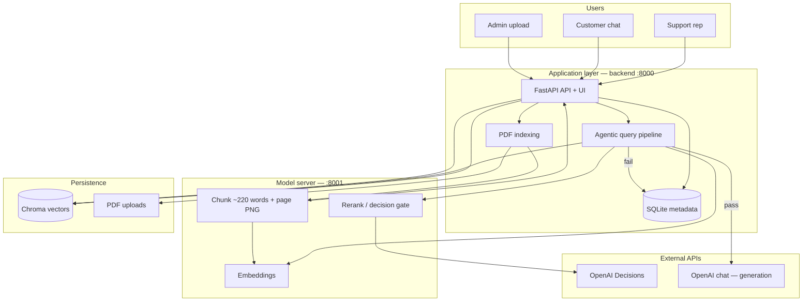
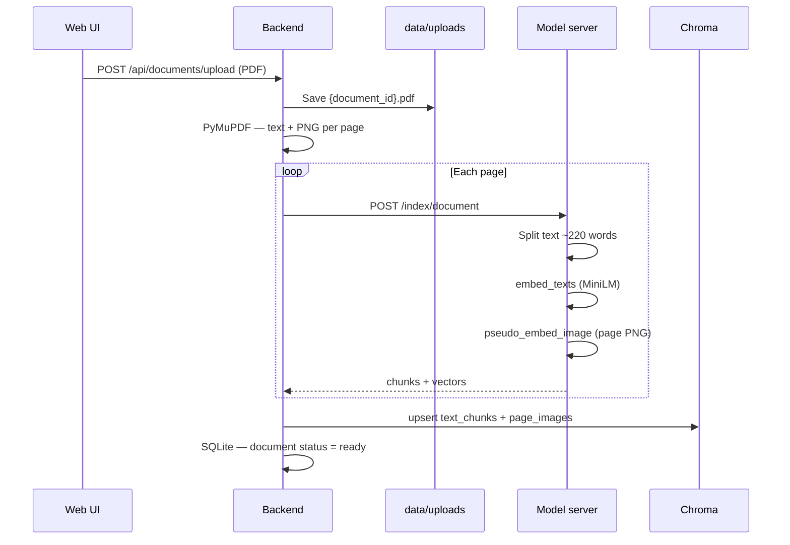
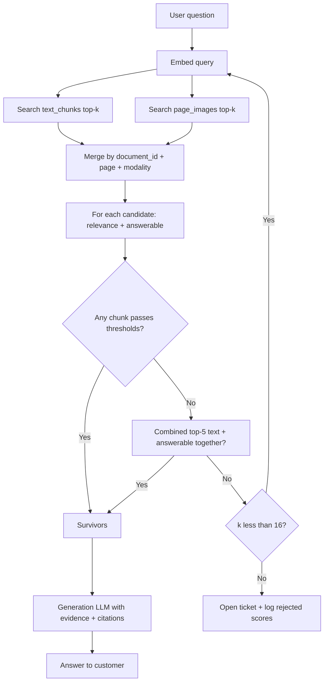
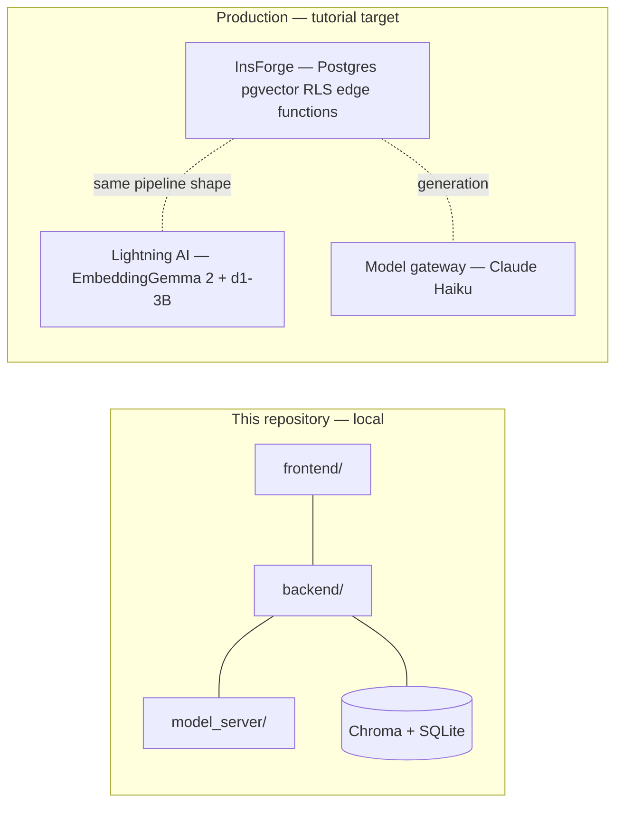

# Problem Statement — Jev-Powered Agentic RAG

This document describes **what problem we are solving**, **how the system is architected** (local prototype and production target), and **where to start if you build it from scratch**.

Related material:

- Tutorial source: [Build a Jev-powered Agentic RAG.pdf](./Build%20a%20Jev-powered%20Agentic%20RAG.pdf)
- Runbook: [README.md](./README.md)

---

## 1. Problem statement

### 1.1 Context

Support and knowledge teams use **RAG** (Retrieval-Augmented Generation): embed user questions, fetch similar passages from documentation, then ask an LLM to answer using those passages.

### 1.2 What goes wrong with “simple RAG”

Simple RAG usually follows a fixed pipeline:

**Embed → Retrieve → Generate (always)**

That creates two failures that **prompt engineering alone** does not fix:

| # | Problem | What users see | Root cause |
|---|---------|----------------|------------|
| 1 | **Insufficient evidence** | Confident wrong answers | The LLM is called even when retrieved chunks do not support an answer |
| 2 | **No action** | Chat keeps “answering” | The app has no structured branch to **escalate**, **ticket**, or **involve a human** |

Multimodal docs make this worse: answers may live in **diagrams or screenshots**, not only in plain text chunks.

### 1.3 What we want instead (agentic RAG + decision model)

An **agentic RAG** system:

1. **Retrieves** evidence (text chunks + page images).
2. **Judges** evidence with a **decision model** (structured probabilities—not free-form chat).
3. **Acts**:
   - If evidence is good enough → **generate** an answer with citations.
   - If not → **retry search**, then **open a ticket** (skip generation).
4. **Closes the loop**: human replies can be **saved to the knowledge base** for future retrieval.

In this repository, the decision step uses **OpenAI Decisions API** (`predicate` ≈ Jev **Noul**). The original tutorial uses **Jev** or **Liquid d1** with the same semantics.

### 1.4 Success criteria

- Answers **only when** retrieved evidence passes configurable thresholds.
- **Escalates** when docs cannot support an answer (no hallucinated support replies).
- **Logs** decisions and rejected candidates for audit and tuning.
- **Indexes** PDFs with text + full-page images for multimodal-ready retrieval.
- Runnable **end-to-end** via web UI: upload → chat → ticket → rep reply → optional KB update.

---

## 2. Solution overview (one paragraph)

We run a **support desk**: admins upload PDFs; customers ask questions in chat. A **model server** embeds and chunks documents; a **vector store** holds embeddings. On each question, the **backend pipeline** embeds the query, searches text and image collections, **reranks** candidates with a **decision model**, and either calls a **generation LLM** with surviving evidence or **creates a ticket** for a human. Representatives resolve tickets and can persist Q&A back into the index.

---

## 3. Architecture diagrams

### 3.1 High-level logical architecture



### 3.2 Document upload and embedding flow



**Where vectors live:** `DATA_DIR/chroma/` (collections `text_chunks`, `page_images`).  
**Where files live:** `DATA_DIR/uploads/`.  
**Where jobs/docs/tickets live:** `DATA_DIR/support.db` (SQLite — no vectors).

### 3.3 Question answering and decision gate



### 3.4 Deployment view (this repo vs production PDF)



| Layer | Local (this repo) | Production (PDF) |
|-------|-------------------|------------------|
| UI + API | `backend/main.py` + `frontend/` | InsForge-hosted web + edge functions |
| Vectors | Chroma `data/chroma/` | Postgres + pgvector (768-d) |
| Embeddings | MiniLM via fastembed | EmbeddingGemma 2 on GPU |
| Decision gate | OpenAI Decisions / mock / Liquid | d1-3B or Jev on model server |
| Generation | OpenAI chat model | Model gateway (e.g. Claude Haiku) |
| Auth / multi-tenant | Single demo company | RLS per company |

---

## 4. Component map (where code lives)

| Concern | Path | Responsibility |
|---------|------|----------------|
| Config & thresholds | `shared/config.py`, `.env` | API keys, `DECISION_PROVIDER`, thresholds |
| Embeddings | `shared/embeddings.py` | Text vectors; page-image placeholder vectors |
| Decisions | `shared/decisions.py` | OpenAI `predicate`, combined evidence gate, mock |
| Model server | `model_server/main.py` | `/embed/*`, `/rerank`, `/index/document` |
| Indexing | `backend/indexing.py` | PDF → pages → call model server |
| Vector + metadata store | `backend/store.py` | Chroma search/upsert; SQLite tickets/docs |
| Agentic pipeline | `backend/pipeline.py` | Retrieve → rerank → generate or ticket |
| HTTP + UI | `backend/main.py`, `frontend/` | Upload, chat, tickets |
| Dev runner | `scripts/run_dev.sh` | Starts :8001 and :8000 |

---

## 5. Starting from scratch — recommended order

Build **bottom-up**. Each phase should be demo-able before moving on.

### Phase 0 — Problem and primitives (no RAG)

**Goal:** Understand decision models vs chat LLMs.

- Read OpenAI [Decisions guide](https://developers.openai.com/api/docs/guides/decisions) (`predicate`, `choice`, `score`).
- Write a 20-line script: one question + one passage → print `relevance` and `answerable` probabilities.

**Maps to:** `shared/decisions.py` (`_openai_scores`).

---

### Phase 1 — Decision gate only (hard-coded passages)

**Goal:** Prove routing without a database.

- Hard-code 5 passages (some relevant, some not).
- Apply thresholds from `.env`; print **answer** vs **escalate**.

**Maps to:** `model_server/main.py` `/rerank` logic + thresholds.

---

### Phase 2 — Retrieval (classic RAG, no gate)

**Goal:** Fetch real chunks from indexed docs.

- Implement embed + vector store (Chroma).
- PDF ingest: extract text, chunk, embed, upsert.
- Query: embed question → top-k search → print chunks.

**Maps to:** `shared/embeddings.py`, `backend/store.py`, `backend/indexing.py`.

---

### Phase 3 — Agentic pipeline (retrieve + decide + act)

**Goal:** Full branch: generate or ticket.

- Dual search (text + image collections).
- Call `/rerank` per candidate; combined-evidence fallback.
- Retry with larger `top_k`; open ticket if still failing.
- Optional generation LLM after gate passes.

**Maps to:** `backend/pipeline.py`.

---

### Phase 4 — Product shell

**Goal:** End-to-end UI and human loop.

- REST: upload, chat, list/resolve tickets.
- Simple HTML UI.
- “Save to knowledge base” on ticket resolve.

**Maps to:** `backend/main.py`, `frontend/`, `scripts/run_dev.sh`.

---

### Phase 5 — Production hardening (optional)

- Replace Chroma with pgvector + RLS.
- GPU model server (EmbeddingGemma 2 + d1-3B).
- Auth, email, realtime dashboard (InsForge pattern from PDF).

---

## 6. From-scratch checklist (empty folder)

If you recreate the project without copying files:

```text
[ ] 1. shared/config.py          — settings from .env
[ ] 2. shared/decisions.py       — OpenAI Decisions + mock
[ ] 3. shared/embeddings.py      — local embedder
[ ] 4. model_server/main.py      — embed + rerank + index HTTP API
[ ] 5. backend/store.py          — Chroma + SQLite
[ ] 6. backend/indexing.py       — PDF → model server
[ ] 7. backend/pipeline.py       — agentic query flow
[ ] 8. backend/main.py           — routes + static UI
[ ] 9. frontend/                 — index.html, app.js, styles.css
[ ] 10. scripts/run_dev.sh       — two uvicorn processes
[ ] 11. .env.example             — keys and thresholds
```

**First command to run after code exists:**

```bash
cp .env.example .env   # set OPENAI_API_KEY
chmod +x scripts/run_dev.sh
./scripts/run_dev.sh
# → http://127.0.0.1:8000
```

---

## 7. Key design decisions (for presentations)

1. **Separate model server** — embeddings and decisions scale on different hardware (matches Lightning AI in the PDF).
2. **Two Chroma collections** — text chunks vs page images; same query embedding searches both.
3. **Per-chunk + combined gate** — strict per passage; fallback when the answer spans multiple pages.
4. **Thresholds in config/DB** — tune gate without redeploying code.
5. **Ticket carries rejected candidates** — reps see *why* the model refused to answer.

---

## 8. Glossary

| Term | Meaning |
|------|---------|
| **Simple RAG** | Retrieve then always call the generation LLM |
| **Agentic RAG** | Retrieve → **decide** → generate **or** escalate (or other actions) |
| **Decision model** | Returns probabilities / choices / scores, not prose |
| **Predicate (OpenAI)** | P(yes) for a yes/no question about the evidence |
| **Gate** | Threshold on relevance + answerable before generation |
| **Survivor** | Candidate chunk that passed the gate |
| **KB loop** | Rep answer embedded as a new chunk for future retrieval |

---

## 9. Common pitfalls (learned from testing)

- The doc may explain a concept **without using the user’s exact words** (e.g. “Simple RAG” vs “decision gate”) — retrieval finds text, but the gate may still reject until thresholds or combined evidence are tuned.
- **Multiple PDFs** in one Chroma index compete in search — reset `data/` or filter by `document_id` for clean demos.
- **Restart both** model server (:8001) and backend (:8000) after code or `.env` changes.

---

*Last updated to match the local prototype in this repository (OpenAI Decisions for the gate, Chroma + SQLite storage).*
